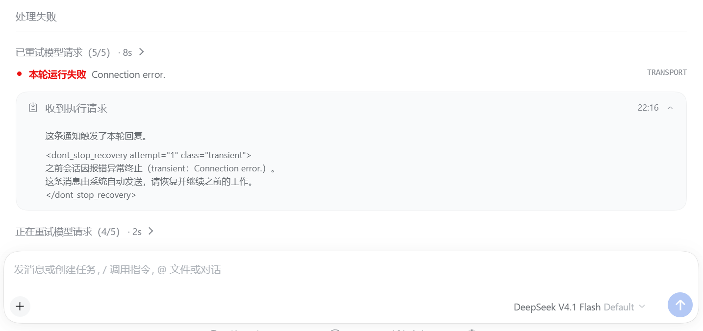
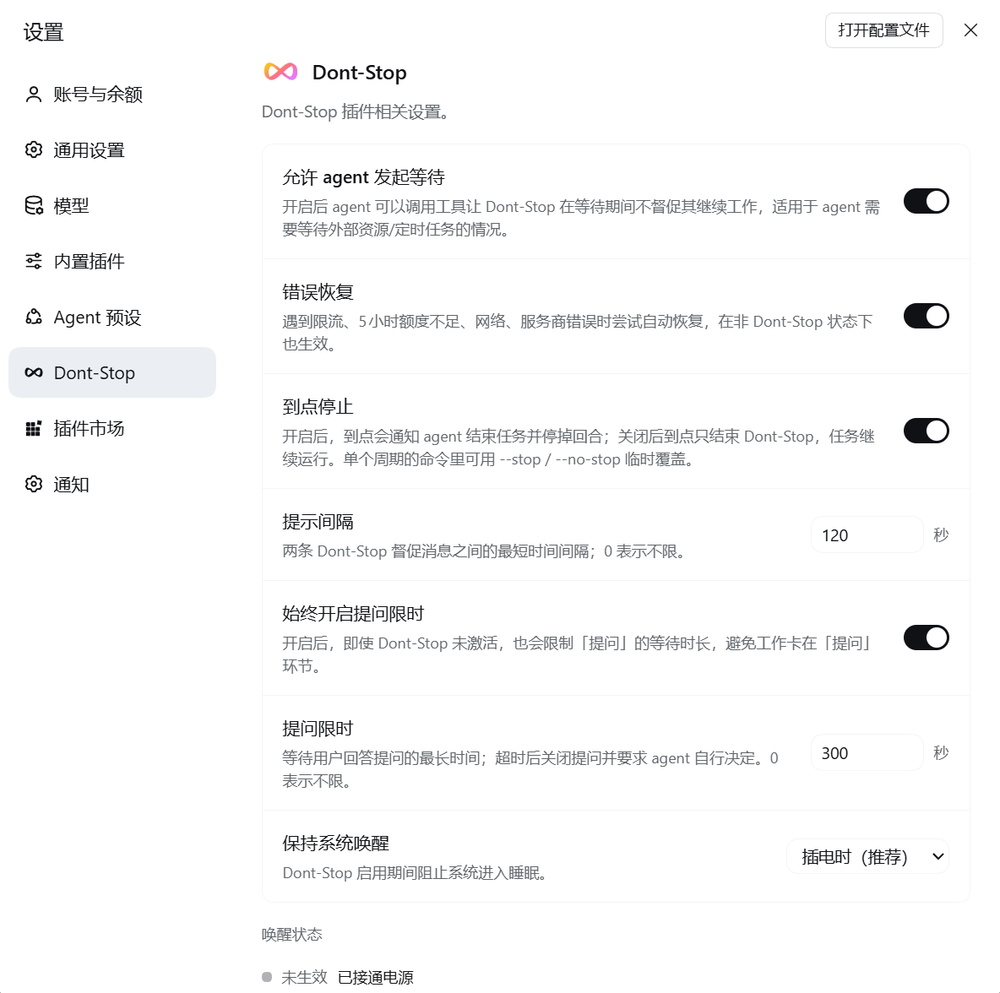

# dsh-dont-stop


[中文](README.md) | English


**"I'm going to sleep — keep pushing the work forward yourself."**

> Dont-Stop keeps an agent working over a long stretch: give it a deadline, and if it finishes early it gets nudged to keep iterating and take on the next step on its own.

- Want the AI to keep iterating by itself, but it stops after a few minutes?
- Left a task running, came back, and all it did was ask two questions?
- Or did a short network or provider hiccup kill the whole run?
- **>>> Turn on Dont-Stop and the agent JUST CAN'T STOP! <<<**

```text
/dont-stop 6h read the README and the docs here, then implement everything they describe.
```

## Screenshots

1. Dont-Stop active


2. Error recovery



## Install

- **In DSH**: Settings → Plugins → Add plugin, and enter `dsh-dont-stop`. The same dialog also accepts the GitHub repository (`TCY07/dsh-dont-stop`) or a local directory path.
- **CLI**: `dsh plugin --profile <profile> add dsh-dont-stop`
- **Uninstall**: remove it on the plugin page, or `dsh plugin --profile <profile> remove dsh-dont-stop`

## Quick start

| Command | What it does |
| --- | --- |
| `/dont-stop 6h` | Work for six hours; without a duration it means six hours |
| `/dont-stop 6h finish the docs and rerun the tests` | Text after the command is sent as a user message |
| `/dont-stop until 22:00` | Work until the next 22:00 (rolls over to tomorrow if it has already passed) |
| `/dont-stop 6h --no-stop` | Temporarily override the plugin setting: no forced stop at the deadline (`--stop` is the opposite) |
| `/dont-stop off` | Stop early |

- **Durations in many spellings**: `6h`, `6 hour`, `6 小时`, `90m`, `8min`, `8分钟`, `1.5h`, `2天`, `3 天`, `1.5天`, `2day`, `2 days`, `2日`. Spaces between the number and the unit are fine, but **compound durations must be written as one word**: `1h30m` and `1小时30分钟` both mean 90 minutes; `1h 30m` is read as 1 hour and `30m` becomes the user instruction. `until` accepts `22:00`, `22：00` (full-width colon), `22点`, `22点30分`, `22时`, `22時30`.

- `--stop` / `--no-stop` may follow other text (before the user instruction), override the "stop at the deadline" setting for the current cycle only, and are reset when that cycle ends.

## Compatibility

Currently built for DeepSeek Harness 0.2.1-rc.5 (Web / Desktop).

The keep-awake mechanism is picked automatically from the host type and the OS, and no system power setting is changed:

| Host / OS | Mechanism |
| --- | --- |
| Desktop app (Electron, Windows / macOS / Linux) | in-process power request (`powerSaveBlocker`) |
| Web / CLI (Windows) | PowerShell calling `SetThreadExecutionState` |
| Web / CLI (macOS) | `caffeinate -i`, watching the host process |
| Web / CLI (Linux) | a `systemd-inhibit` lock |
| WSL / containers | not possible; the plugin only tells you to set the host machine instead |

These can never be prevented by a plugin, only by a system setting: closing the lid, sleeping or hibernating manually, forced hibernation on critical battery, power loss and blue screens.

## Features

- **Deadline supervision**: set a deadline; finishing early gets the agent nudged to keep iterating until the time is up.
- **Autonomous progress**: each nudge asks the agent to check what is left, set the next goal itself, and widen or raise the goal when that is the better move — it picks up the next piece of work instead of being sent a bare "continue".
- **Automatic error recovery**: on rate limits, exhausted quota, request timeouts, server errors and network failures it waits a while and then tries again. (This wraps a second wait around DSH's own retry, so a single hiccup can back off for hours.)
- **Stop at the deadline**: (opt-in) when the deadline arrives, the agent is asked to wrap up quickly and stop working.
- **Question time limit**: a question that goes unanswered for too long is closed and the agent is asked to decide for itself, so it never sits stuck waiting for a reply.
- **Keep the system awake**: (opt-in) blocks system sleep while Dont-Stop is active.

## Settings

Everything lives on the Dont-Stop page in the DSH settings, and takes effect immediately without disturbing the current supervision cycle.

| Setting | Default | What it does |
| --- | --- | --- |
| Let the agent declare a wait | on | The agent may call a tool to say it is waiting on an external resource; it is not nudged while that wait lasts |
| Error recovery | on | Resumes work after rate limits, exhausted quota, network and provider errors; also applies outside Dont-Stop sessions |
| Stop at the deadline | on | At the deadline the agent is told to wrap up and the turn is stopped; off ends supervision only and the task keeps running |
| Prompt interval | 0 s (no limit) | Shortest gap between two Dont-Stop nudges |
| Always limit question waits | off | Applies the question limit even while Dont-Stop is not active |
| Question wait limit | 300 s | Longest wait for an answer; after that the question is closed and the agent decides on its own; 0 means no limit |
| Keep the system awake | on AC power | Blocks system sleep while Dont-Stop is active; choose off / on AC power / always |



## Development

```sh
npm test
```

## Changelog

- **0.2.0**: keeps the system awake while Dont-Stop is active (mechanism picked per platform, no admin rights).
- **0.1.0**: first release.

## License

[MIT](LICENSE)
