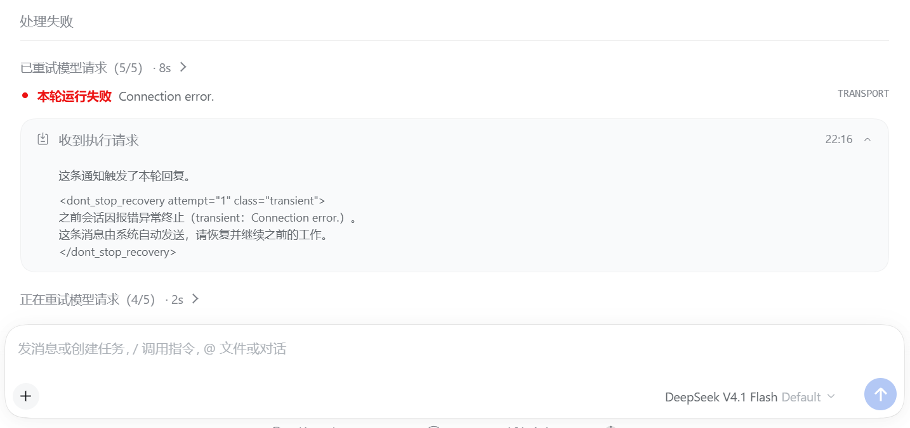
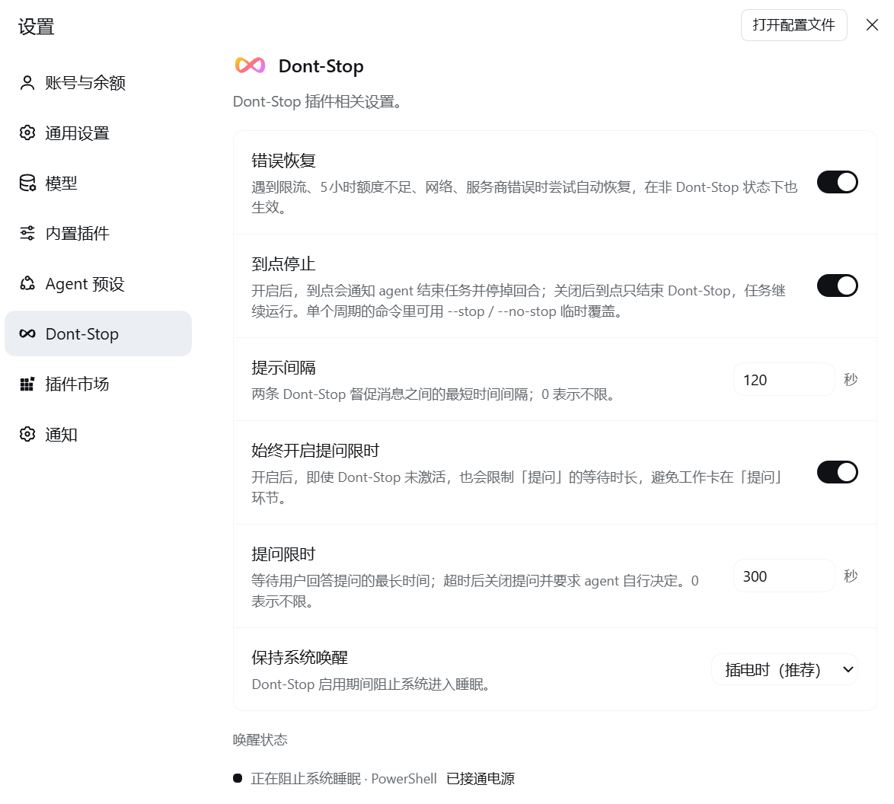

# dsh-dont-stop


[English](README.en.md) | 中文


**"我去睡觉了，你自己往后推进工作。"**

> Dont-Stop 插件用于保证智能体长时间持续工作：设定一个截止时间，若 AI 提前完成任务，插件将自动督促智能体继续迭代，自主推进下一步任务。

- 想要 AI 自己迭代推进工作，却经常发现其只工作了一小会就停下了？
- 布置任务后离开，回来发现 AI 只抛了两个问题，实际什么也没干？
- 或是因为临时的网络波动、模型提供商问题导致 AI 工作中断？
- **>>> 启用 Dont-Stop 插件，让 AI 根·本·停·不·下·来！<<<**

```text
/dont-stop 6h 读一下当前目录下的README和相关文档，把相关功能全部落地实现。
```

## 使用截图

1. Dont-Stop 激活状态


2. 错误自动恢复



## 安装

- **在 DSH 里装**：打开侧边栏的「插件」页 → 添加插件，填 `dsh-dont-stop`。同一个入口也接受 `github:TCY07/dsh-dont-stop`（或 `https://github.com/TCY07/dsh-dont-stop`）和本地绝对目录路径。
- **命令行**：`dsh plugin --profile <profile> add dsh-dont-stop`
- **卸载**：在插件页移除，或 `dsh plugin --profile <profile> remove dsh-dont-stop`

## 快速上手

| 命令 | 效果 |
| --- | --- |
| `/dont-stop 6h` | 干到 6 小时后；不带时长默认 6 小时 |
| `/dont-stop 6h 把文档补完再跑一遍测试` | 命令后接具体指令：将作为一条用户消息发送 |
| `/dont-stop until 22:00` | 干到下一个 22:00（今天已过则顺延到明天） |
| `/dont-stop 6h --no-stop` | 使用 `--no-stop` 临时覆盖插件设置，到点后不强制停止（`--stop` 相反） |
| `/dont-stop off` | 提前收工 |

- **支持各种时间写法**：`6h`、`6 hour`、`6 小时`、`90m`、`8min`、`8分钟`、`1.5h`、`2天`、`3 天`、`1.5天`、`2day`、`2 days`、`2日`。数字与单位之间可以有空格，但**多段时长要写在一起**：`1h30m`、`1小时30分钟` 可正确解析为 90 分钟；写成 `1h 30m` 会被解析为 1 小时，`30m` 会被当成用户指令。`until` 接受 `22:00`、`22：00`（中文冒号）、`22点`、`22点30分`、`22时`、`22時30`。

- `--stop` / `--no-stop` 参数可附加在其他指令后面（用户指令之前），将临时覆盖插件设置页的「到点停止」选项，只作用于当前这一轮 Dont-Stop 生命周期。

## 兼容性

当前开发版本为 DeepSeek Harness 0.2.1-rc.5（Web / Desktop）。

保持唤醒按 DSH 类型与系统自动选择方式，不修改系统电源设置：

| DSH / 系统 | 手段 |
| --- | --- |
| 桌面版（Electron，Windows / macOS / Linux） | 进程内电源请求（`powerSaveBlocker`） |
| Web / CLI（Windows） | PowerShell 调用 `SetThreadExecutionState` |
| Web / CLI（macOS） | `caffeinate -i`，并监视宿主进程 |
| Web / CLI（Linux） | `systemd-inhibit` 持锁 |
| WSL / 容器 | 不生效，只提示去宿主机设置 |

以下情况插件无法阻止，只能靠系统设置：合盖睡眠、手动睡眠/休眠、电量临界时强制休眠、断电或蓝屏。

## 功能

- **持续工作**：给 agent 设定一个截止时间，它提前完成任务也会被督促继续迭代，一直工作到时间到。
- **自主推进**：督促 agent 自己检查遗留问题、制定下一步目标，必要时扩大范围或升级目标——而不只是简单的“继续”。
- **错误自动恢复**：碰到限流、额度不足、请求超时、服务端错误、网络中断时，等待一段时间后自动重试；（在 DSH 内置的重试框架外又套了一层：单次最多等 90 分钟，连续同类失败可累计数小时）
- **定时停止**：当截止时间到达时，要求 agent 迅速收尾，并在一段缓冲时间后强停。
- **提问限时**：agent 提问后长时间等不到回答，则自动关闭提问并自行决定，避免卡在等待用户回答的状态。
- **保持系统唤醒**：Dont-Stop 启用期间阻止系统睡眠（可选）。

## 设置

在 DSH 设置页的 Dont-Stop 一项里调整，改完立即生效，不影响正在进行的这一轮监督。

| 设置 | 默认值 | 说明 |
| --- | --- | --- |
| 错误恢复 | 开 | 遇到限流、额度不足、网络、服务商错误时自动重试；打开后在非 Dont-Stop 状态下也生效 |
| 到点停止 | 开 | 到点叫醒 agent 收尾，并停掉残留的 subagent 与后台任务；关闭后到点不强行停止 |
| 提示间隔 | 0 秒（不限） | 两条督促消息之间的最短间隔 |
| 始终开启提问限时 | 关 | Dont-Stop 未启用时也限制提问的等待时长 |
| 提问限时 | 300 秒 | 等用户回答的上限时间，超时后关闭提问并要求 agent 自行决定；0 表示不限 |
| 保持系统唤醒 | 插电时 | Dont-Stop 启用期间阻止系统睡眠；可选关闭 / 插电时 / 始终 |



## 开发

```sh
npm test
```

## 更新记录

- **0.2.1**：修复 `dont_stop_wait` 相关问题。
- **0.2.0**：Dont-Stop 启用期间保持系统唤醒（跨平台自动选择手段，不需要管理员权限）。
- **0.1.0**：首个版本。

## License

[MIT](LICENSE)
